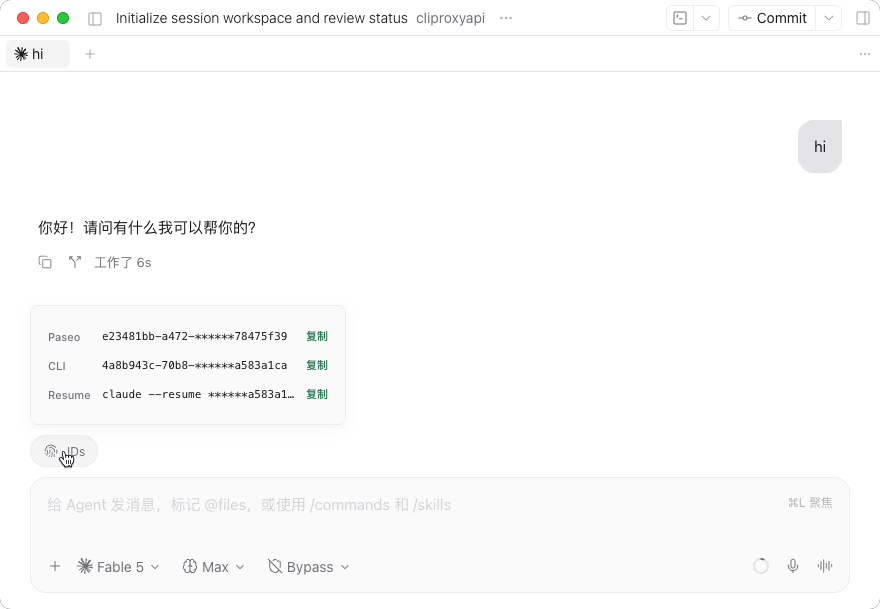

# Session IDs for Paseo (`session-ids`)

[English](#english) | [中文说明](#中文说明)



---

## English

A lightweight, productivity plugin for [Paseo](https://github.com/getpaseo/paseo) desktop client to view and copy the **Paseo Session ID** and underlying **CLI Session ID** with one click.

### Key Features

- 🏷️ **Composer Pill Button**:
  Adds an `IDs` button right above the chat composer, next to Tasks and Subagents.
- 📋 **Minimalist Masked Popover**:
  - Clean, single-line display for `Paseo ID`, `CLI ID`, and the `Resume` command.
  - Smart privacy masking (prefix + `******` + last 8 characters).
  - One-click copy for the entire row or via the copy button.
- 🔄 **Supported CLI Providers**:
  - **Antigravity (`agy`)**: Decodes and displays clean `conversationId` and generates `agy --conversation <id>`.
  - **Claude**: Native session UUID and `claude --resume <id>`.
  - **Pi**: Native session ID and `pi --session <id>`.
  - **Codex**: Native thread ID and `codex resume <id>`.
  - **Hermes / OMP / OpenCode**: Respective native IDs and resume commands.
- 🌐 **Native Paseo 0.13 Localization**:
  - Built-in English and Simplified Chinese (`zh-CN`) support.
- ⌨️ **Slash Command & Palette**:
  - `/ids` slash command to copy both IDs directly.
  - Palette command: "Copy current session IDs".

### Install

```bash
paseo plugin add Ran-Xing/paseo-session-ids
```

---

## 中文说明

一款为 [Paseo](https://github.com/getpaseo/paseo) 桌面客户端打造的高效插件，支持在会话中一键查看、复制当前会话的 **Paseo 会话 ID** 与底层 **CLI 会话 ID**。

### 🎯 痛点解决

在日常使用 Paseo 与各大 Agent 交互时，存在**两套不同的会话体系与标识**：
1. **Paseo 会话 ID (Agent ID)**: Paseo 客户端和 Daemon 内部用于管理生命周期、工作区归属、状态同步的全局唯一 ID。
2. **CLI 会话 ID (底层会话标识)**: 底层驱动 Agent（如 `agy` / `claude` / `pi` / `codex` 等）真正的会话与上下文标识：
   - **Antigravity (`agy`)**: 自动提取底层 `conversationId`，生成恢复命令 `agy --conversation <id>`。
   - **Claude**: 原生会话 UUID，可直接用于 `claude --resume <id>`。
   - **Pi**: 原生 Session ID 与 JSONL 会话存储，可用于 `pi --session <id>`。
   - **Codex**: 原生 Thread ID，可用于 `codex resume <id>`。

### ✨ 核心特性

- 🏷️ **Composer Pill 常驻按钮**:
  在会话输入框下方的追踪条增加 `IDs` 按钮，随点随看。
- 📋 **极简单行掩码设计**:
  - 去除厚重标题与冗余边框卡片，单行展示 `Paseo`、`CLI` 与 `Resume` 恢复命令。
  - 智能前后掩码格式化，保护隐私同时便于快速辨识。
  - 支持直接点击整行或右侧轻量“复制”按钮一键复制完整值。
- 🌐 **Paseo 0.13 原生国际化 (Runtime Translations)**:
  - 接入官方 `defineTranslations` / `useTranslation`，支持中英双语自适应切换。
- ⌨️ **多入口支持**:
  - **斜杠命令**: 输入 `/ids` 即可一键复制双 ID 到剪贴板。
  - **命令中心**: <kbd>Cmd</kbd> + <kbd>K</kbd> 搜索 `复制当前会话 ID`。

### 🚀 安装与管理

```bash
paseo plugin add Ran-Xing/paseo-session-ids
```

本地开发管理：
```bash
# 重新加载插件
paseo plugin reload session-ids

# 查看运行日志
paseo plugin logs session-ids
```
